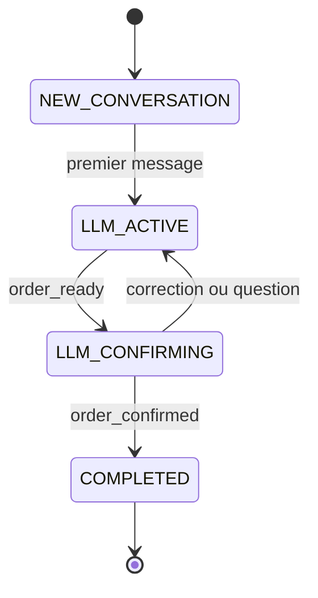

# Rebbah AI

*Rebbah (ربّاح) : « celui qui fait gagner ».*

Rebbah AI est une plateforme conversationnelle multi-agents dédiée à l'e-commerce. Elle accueille les clients d'une boutique sur Messenger et Instagram, répond à leurs questions, recommande des produits, enregistre leurs commandes et assure le suivi après-vente, en dialecte tunisien (Derja) comme en français.

Le projet a été réalisé dans le cadre d'un Projet de Fin d'Études (PFE).

---

## Sommaire

1. [Fonctionnalités](#fonctionnalités)
2. [Architecture](#architecture)
3. [Système multi-agents](#système-multi-agents)
4. [Machine à états de la conversation](#machine-à-états-de-la-conversation)
5. [Stack technique](#stack-technique)
6. [Structure du dépôt](#structure-du-dépôt)
7. [Installation et démarrage](#installation-et-démarrage)
8. [Configuration](#configuration)
9. [Intégration Meta (Messenger et Instagram)](#intégration-meta-messenger-et-instagram)
10. [API](#api)
11. [Tests](#tests)
12. [Contribution](#contribution)
13. [Propriété et auteurs](#propriété-et-auteurs)

---

## Fonctionnalités

- **Dialogue multi-agents** : un routeur basé sur Gemini oriente chaque message vers l'agent compétent (FAQ, vente, commande, après-vente), orchestrés avec Google ADK.
- **Collecte de commande structurée** : l'agent de commande extrait les informations du client et les valide par un schéma Pydantic avant toute écriture dans le CRM.
- **Recherche visuelle (Visual RAG)** : à partir d'une photo envoyée par le client, le service de vision (CLIP et pgvector) identifie le produit du catalogue correspondant.
- **Debouncer à fenêtre glissante** : les messages successifs rapides d'un même client sont regroupés dans Redis en un seul message avant d'invoquer le modèle, ce qui évite les exécutions concurrentes et les réponses fragmentées.
- **Bascule vers un opérateur humain** : prise de contrôle manuelle depuis le dashboard, désactivation automatique du bot si le quota est dépassé ou si l'API Gemini échoue trois fois de suite pour un client (circuit breaker).
- **Contrôle du budget** : chaque appel au modèle est comptabilisé (jetons et coût) et comparé au plafond mensuel de la boutique.
- **Contrôle de stock** : une commande ne peut être confirmée que si les produits demandés sont disponibles dans le catalogue.
- **Dashboard marchand** : configuration du bot (ton, langue, règles), synchronisation du catalogue, supervision des conversations.

---

## Architecture

```text
Meta Messenger / Instagram (webhook)
              |
              v
   backend-orchestrator :8010        Django : API, Dialog Manager, agents ADK
              |
              +--> celery-worker     Traitement asynchrone et debouncing
              +--> vision-service    :8020   FastAPI : embeddings CLIP, recherche visuelle
              +--> redis             :6380   Mémoire chaude, tampon de debouncing, broker
              +--> db (PostgreSQL)   :5434   Données CRM, embeddings (pgvector)

   frontend :3010                    React : dashboard marchand
```

### Services Docker

| Service | Port externe | Port interne | Rôle |
| --- | --- | --- | --- |
| `backend-orchestrator` | 8010 | 8000 | Webhooks Meta, API REST, Dialog Manager multi-agents, facturation, administration Django. |
| `celery-worker` | n/a | n/a | Exécution asynchrone du pipeline et du debouncing. Même image que le backend. |
| `frontend` | 3010 | 3000 | Dashboard marchand (React, TypeScript, Tailwind CSS). |
| `vision-service` | 8020 | 8002 | Embeddings CLIP à 512 dimensions et recherche par similarité visuelle. GPU Nvidia optionnel. |
| `db` | 5434 | 5432 | PostgreSQL avec l'extension pgvector. |
| `redis` | 6380 | 6379 | Contexte de conversation, tampon de debouncing, compteurs du circuit breaker, broker Celery. |

Toute la logique NLU s'exécute dans `backend-orchestrator` : il n'existe pas de service NLU externe.

### Mémoire à deux niveaux

- **Mémoire chaude (Redis)** : historique récent de la conversation, clé `chat_context:{shop_id}:{user_id}`, expiration d'une heure. Elle est reconstruite depuis PostgreSQL en cas d'absence.
- **Mémoire froide (PostgreSQL)** : leads, conversations, messages, commandes, journaux d'utilisation.

---

## Système multi-agents

Le traitement conversationnel est implémenté avec Google ADK dans `backend-orchestrator/apps/gateway/services/agents.py`.

**Routeur.** À chaque message, la fonction `determine_target_agent_with_llm` interroge Gemini avec l'historique récent. La décision est validée par le schéma Pydantic `AgentRoutingDecision` (`target_agent`, `reasoning`).

**Agents spécialisés.** Chaque agent hérite de `google.adk.agents.Agent` et s'exécute dans un `InMemoryRunner`.

| Agent | Responsabilité |
| --- | --- |
| `FAQ` | Questions générales : horaires, adresse, contact, livraison, modalités d'achat. |
| `SALES` | Exploration du catalogue et recommandations via l'outil `search_products`. |
| `CHECKOUT` | Collecte des informations de commande, validées par `DynamicCheckoutSchema` (`response_text`, `extracted_entities`, `order_ready`, `order_confirmed`, `carousel_items`). Vérifie la disponibilité du produit avant de collecter. |
| `POST_SALES` | Support après-vente et suivi de commande via l'outil `check_order_status`. |

Les instructions de chaque agent sont construites dynamiquement à partir de la configuration de la boutique (`BotConfiguration`) : nom de l'assistant, domaine d'activité, ton, règles de langue, politique de livraison, informations de commande requises.

---

## Machine à états de la conversation



| État | Description |
| --- | --- |
| `NEW_CONVERSATION` | Conversation créée, aucun échange traité. |
| `LLM_ACTIVE` | Dialogue en cours (FAQ, vente, collecte de commande). |
| `LLM_CONFIRMING` | Informations complètes : le récapitulatif est présenté, le client doit confirmer. |
| `COMPLETED` | Commande confirmée et enregistrée dans le CRM. |

Deux garde-fous déterministes encadrent les transitions : une commande ne peut passer à `COMPLETED` que depuis `LLM_CONFIRMING`, et la confirmation est annulée si un produit est en rupture de stock au moment de la validation.

---

## Stack technique

| Couche | Technologies |
| --- | --- |
| Backend | Python 3.10, Django, Django REST Framework, SimpleJWT, Celery |
| IA | Google ADK, Google GenAI (Gemini), Pydantic |
| Vision | FastAPI, PyTorch, Transformers (`openai/clip-vit-base-patch32`) |
| Données | PostgreSQL, pgvector (index HNSW, distance cosinus), Redis |
| Frontend | React 19, TypeScript, Tailwind CSS, React Router |
| Stockage média | Azure Blob Storage |
| Infrastructure | Docker, Docker Compose |

---

## Structure du dépôt

```text
.
|-- backend-orchestrator/        Backend Django
|   |-- apps/gateway/            Webhooks, pipeline de messages, agents, debouncer
|   |   |-- services/            agents.py, pipeline.py, context_manager.py, entity_normalizer.py
|   |   `-- views/               webhook.py, catalog.py, health.py
|   |-- apps/crm/                Modèles, API du dashboard, administration, facturation
|   |-- core/                    Réglages Django, Celery, middleware
|   |-- docs/                    Documentation d'API
|   `-- tests/                   Scripts de test d'intégration
|-- frontend/                    Dashboard React
|-- vision-service/              Service de vision (FastAPI, CLIP)
|-- docker-compose.yml
`-- .env.example
```

---

## Installation et démarrage

### Prérequis

- Docker Desktop avec Docker Compose
- Une clé API Google Gemini
- Un compte de stockage Azure Blob pour les images du catalogue (nécessaire pour l'import de produits)

### 1. Récupérer le projet et configurer l'environnement

```bash
git clone https://github.com/BassemKallel/rebbah-ai.git
cd rebbah-ai
cp .env.example .env
```

Renseignez ensuite les valeurs dans `.env` (voir [Configuration](#configuration)).

### 2. Démarrer les services

```bash
docker compose up --build -d
```

Au démarrage, le backend applique les migrations, collecte les fichiers statiques et exécute `setup_initial_data`, qui crée le superutilisateur Django et la boutique par défaut à partir des variables `DJANGO_SUPERUSER_*` et `SHOP_ID`.

### 3. Accéder aux interfaces

| Interface | URL |
| --- | --- |
| Administration Django | http://localhost:8010/admin/ |
| Dashboard marchand | http://localhost:3010 |
| Santé des services (session admin requise) | http://localhost:8010/api/v1/gateway/health/ |

Un utilisateur marchand, lié à une boutique, peut être créé pour le dashboard :

```bash
docker exec rebbah-ai-backend python manage.py create_merchant_user \
  --username <utilisateur> --password <mot_de_passe> --shop-id <SHOP_ID>
```

### Commandes utiles

```bash
# Appliquer les changements de code Python
docker compose restart backend-orchestrator celery-worker

# Suivre les journaux du backend
docker logs -f rebbah-ai-backend

# Arrêter les services
docker compose down
```

---

## Configuration

Toute la configuration passe par le fichier `.env` à la racine, dont le modèle est `.env.example`. Ne versionnez jamais ce fichier.

| Variable | Description |
| --- | --- |
| `POSTGRES_USER`, `POSTGRES_PASSWORD`, `POSTGRES_DB` | Accès à la base PostgreSQL. |
| `VECTOR_DB_HOST`, `VECTOR_DB_PORT`, `VECTOR_DB_USER`, `VECTOR_DB_PASSWORD`, `VECTOR_DB_NAME` | Accès du service de vision à la base pgvector. |
| `DJANGO_SECRET_KEY` | Clé secrète Django. |
| `DJANGO_DEBUG` | `True` en développement uniquement. |
| `ALLOWED_HOSTS` | Hôtes autorisés, séparés par des virgules. |
| `CORS_ALLOWED_ORIGINS`, `CSRF_TRUSTED_ORIGINS` | Origines supplémentaires (domaine public du dashboard), séparées par des virgules. |
| `FIELD_ENCRYPTION_KEY` | Clé de chiffrement des secrets des boutiques stockés en base (jetons de pages Meta, clés API). |
| `GEMINI_API_KEY`, `GEMINI_MODEL` | Accès à Gemini et modèle par défaut. |
| `VISION_SERVICE_URL`, `VISION_SEARCH_PATH`, `SIMILARITY_THRESHOLD` | Service de vision et seuil de similarité visuelle (0,75 par défaut). |
| `AZURE_ACCOUNT_NAME`, `AZURE_ACCOUNT_KEY`, `AZURE_CONTAINER` | Stockage des images du catalogue. |
| `META_VERIFY_TOKEN`, `META_APP_SECRET` | Vérification du webhook et validation de la signature `X-Hub-Signature-256`. |
| `NGROK_URL` | URL du tunnel de développement, ajoutée automatiquement aux origines CSRF. |
| `DJANGO_SUPERUSER_USERNAME`, `DJANGO_SUPERUSER_EMAIL`, `DJANGO_SUPERUSER_PASSWORD` | Compte administrateur créé au premier démarrage. |
| `SHOP_ID`, `SHOP_NAME` | Boutique initiale créée au premier démarrage. |
| `EXTERNAL_REQUEST_TIMEOUT` | Délai maximal des appels externes, en secondes. |

---

## Intégration Meta (Messenger et Instagram)

Meta exige une URL HTTPS publique pour le webhook.

**En développement, avec ngrok :**

1. Ouvrez un tunnel vers le backend : `ngrok http 8010`.
2. Dans le portail Meta Developer, définissez l'URL de rappel : `https://<sous-domaine>.ngrok-free.app/api/v1/gateway/meta/webhook`.
3. Saisissez comme jeton de vérification la valeur de `META_VERIFY_TOKEN`.

**En production**, l'URL de rappel est `https://<DOMAINE_PUBLIC>/api/v1/gateway/meta/webhook`.

Meta n'autorisant qu'une seule URL de webhook active par page de test, les membres de l'équipe doivent se coordonner : chacun met à jour l'URL de rappel avec son propre tunnel lorsqu'il teste en local.

---

## API

Les routes principales, toutes préfixées par `/api/v1/` :

| Méthode et route | Description | Authentification |
| --- | --- | --- |
| `GET/POST gateway/meta/webhook` | Webhook officiel Meta (vérification et réception des messages). | Signature Meta |
| `POST gateway/messenger/poc` | Point d'entrée de test simplifié. | En-tête `X-Shop-Token` |
| `POST gateway/message/process/` | Traitement synchrone d'un message par un serveur tiers. La réponse du bot est renvoyée dans le corps HTTP. | En-tête `X-Shop-Token` |
| `POST gateway/catalog/upload` | Ajout d'un produit : image vers Azure, vectorisation CLIP. | Non restreinte (`shop_id` requis) |
| `POST gateway/catalog/import-csv` | Import de catalogue par fichier CSV. | Non restreinte (`shop_id` requis) |
| `POST crm/conversations/<id>/takeover/` | Prise de contrôle humaine : le bot est désactivé pour la conversation. | JWT ou jeton de boutique |
| `POST crm/conversations/<id>/release/` | Réactivation du bot. | JWT ou jeton de boutique |
| `POST crm/conversations/<id>/agent-reply/` | Envoi d'un message par l'opérateur. | JWT ou jeton de boutique |
| `GET gateway/health/` | État de PostgreSQL, Redis, du service de vision et de Celery. | Session administrateur |

Le détail des requêtes et des réponses se trouve dans `backend-orchestrator/docs/`.

Sur les routes de messages, un debouncer de 5 secondes regroupe les messages rapprochés d'un même client. Une requête remplacée par un message plus récent répond `queued_and_skipped` (ou `skipped` sur la route synchrone).

---

## Tests

Trois scripts d'intégration s'exécutent dans le conteneur backend. Ils s'appuient sur une boutique configurée (boutique, configuration du bot, catalogue vectorisé et clé Gemini) et appellent le modèle réel.

| Script | Objet |
| --- | --- |
| `tests/test_run.py` | Parcours conversationnel complet : routage, vente, collecte de commande, confirmation, plus les tests unitaires du normaliseur d'entités. |
| `tests/test_debounce.py` | Deux requêtes concurrentes à une seconde d'intervalle : la première est ignorée, la seconde fusionne les textes et s'exécute. |
| `tests/test_raw_output.py` | Structure JSON brute renvoyée par le pipeline. |

```bash
docker exec rebbah-ai-backend python tests/test_run.py
docker exec rebbah-ai-backend python tests/test_debounce.py
docker exec rebbah-ai-backend python tests/test_raw_output.py
```

---

## Contribution

Les règles de développement sont détaillées dans [CONTRIBUTING.md](CONTRIBUTING.md). En résumé :

1. Créez une branche depuis `dev` (`feat/...` ou `fix/...`).
2. Les poussées directes vers `main` et `dev` sont bloquées : ouvrez une Pull Request vers `dev`.
3. Gardez les fonctions courtes à responsabilité unique, déclarez les imports en tête de fichier et typez toutes les signatures.

---

## Propriété et auteurs

Ce projet est la propriété de l'équipe Rebbah AI, dans le cadre de son Projet de Fin d'Études (PFE).

**Auteurs :**

- Bassem Kallel
- Aziz Belgaied
