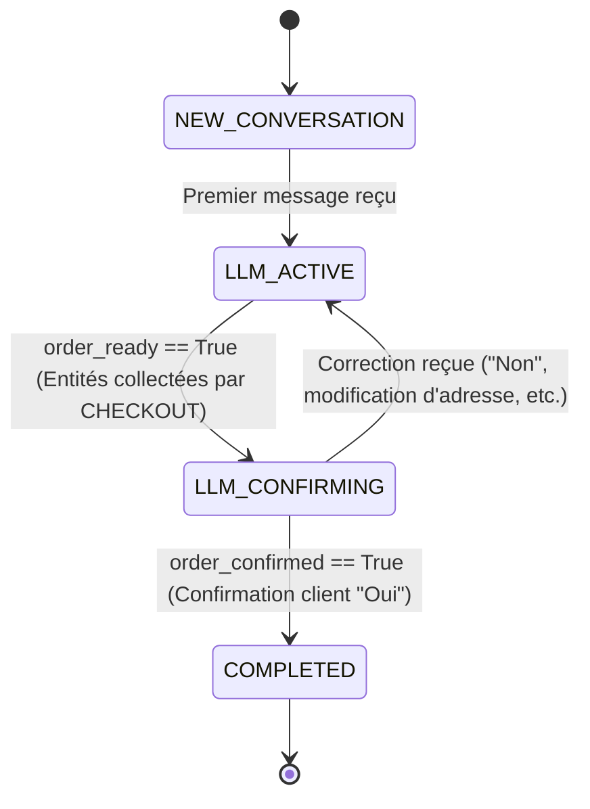

# 📖 Carte de Contexte & Spécifications Techniques — TikTak-AI v2

Ce document sert de **bible technique, de guide d'architecture de référence et d'historique d'avancement** pour les développeurs et les agents de codage IA. Son objectif est de fournir une compréhension immédiate de l'architecture, du rôle de chaque fichier clé, des signatures d'APIs exactes, des schémas de base de données complets, et du statut des dernières livraisons pour éliminer le besoin de re-scanner l'ensemble de la base de code.

---

## 1. 📖 Fiche d'Identité & Contexte Général

* **Nom du Projet** : TikTak-AI (v2)
* **Cadre** : Projet de Fin d'Études (PFE)
* **Objectif** : Plateforme conversationnelle intelligente multilingue (Derja tunisienne et français) dédiée à l'e-commerce autonome. Elle permet d'accueillir les clients, de répondre à leurs questions (FAQ), de leur recommander des produits (SALES), et d'enregistrer leurs commandes de manière autonome et structurée (CHECKOUT) directement en BDD CRM, tout en gérant le suivi après-vente (POST_SALES).
* **Stack Principale** : Django (Backend CRM & Orchestration), React (Dashboard client TikTak Pro), FastAPI + PyTorch + Transformers (CLIP Vision Service), Redis (Hot memory & Debouncing buffer), PostgreSQL + pgvector (BDD relationnelle et embeddings).

---

## 2. 🏗️ Architecture Globale & Vérité Réelle (5 Services)

L'architecture physique réelle et active de TikTak-AI v2 est constituée exclusivement de **5 services** exécutés via Docker Compose.

```text
Meta Messenger (Webhook)
       │
       ▼
Production: https://ai2.tiktakpro.com/  /  Local: ngrok tunnel (port 8010)
       │
       ▼
backend-orchestrator :8010   (Django — Dialog Manager & Multi-Agents ADK)
       │
       ├──► vision-service    :8020 (FastAPI — CLIP Vector Search)
       ├──► redis             :6380 (Hot Memory & Sliding Window Debouncer)
       └──► postgres-db (db)  :5434 (PostgreSQL + pgvector)
```

### Rôle et Spécification des Services

1. **`backend-orchestrator`** (port externe `8010`, interne `8000`) :
   * Django. Conteneur principal gérant les endpoints de webhooks Messenger et Instagram, le Dashboard API, la gestion de quota financier, la resynchronisation de catalogue, la Cold Memory CRM et l'orchestration multi-agent ADK.
2. **`frontend`** (port externe `3010`, interne `3000`) :
   * React (TypeScript & Tailwind CSS). Dashboard administrateur de gestion pour les marchands (takeovers manuels, configuration du bot et des tonalités, suivi du catalogue).
3. **`vision-service`** (port externe `8020`, interne `8002`) :
   * FastAPI + CLIP. Service d'extraction d'embeddings de 512 dimensions et de recherche par similarité visuelle (Visual RAG).
4. **`db`** (port externe `5434`, interne `5432`) :
   * Image `ankane/pgvector:v0.5.1`. PostgreSQL avec extension `pgvector` active. Stocke les données Django, les tables CRM, et les vecteurs d'embeddings CLIP des images produits dans `crm_itemvector`.
5. **`redis`** (port externe `6380`, interne `6379`) :
   * Image `redis:7-alpine`. Utilisé pour maintenir le cache de conversation à chaud (Hot Memory) et servir de zone tampon d'exclusion mutuelle pour le debouncer de messages glissants.

> ⚠️ **VÉRITÉ TERRAIN CRITIQUE** : Il n'existe **aucun conteneur externe `nlu-service`** ni **aucun conteneur de synchronisation `sync-worker`**. Tout le NLU et l'orchestration s'exécutent directement dans `backend-orchestrator`.

---

## 3. 🤖 Architecture Multi-Agents & Google ADK

Le traitement conversationnel est géré par le framework officiel **Google ADK (Agent Development Kit)** au sein du module `backend-orchestrator/apps/gateway/services/agents.py`.

### Le Routeur Intelligent
À chaque entrée de message, la méthode `determine_target_agent_with_llm` utilise l'API Gemini et l'historique conversationnel récent pour router la requête vers l'un des 4 agents spécialisés. Cette décision est validée via le schéma Pydantic `AgentRoutingDecision` contenant `target_agent` (choix strict parmi `FAQ`, `SALES`, `CHECKOUT`, `POST_SALES`) et `reasoning`.

### Les 4 Agents Spécialisés
Chaque agent hérite de la classe `Agent` de Google ADK et s'exécute dans un environnement isolé `InMemoryRunner` avec des règles strictes :
* **Agent `FAQ`** : Traite les questions générales (horaires de la boutique, adresse, contact, politiques d'achat). Répond chaleureusement en dialecte tunisien (Derja) ou en français.
* **Agent `SALES`** : Recommande des produits à l'aide de l'outil `search_products`. Le catalogue de la boutique extrait d'un `ItemVector` est formaté et injecté dynamiquement dans sa consigne système à chaque appel.
* **Agent `CHECKOUT`** : Responsable de la collecte des informations CRM. Ses retours sont régis par le schéma Pydantic `DynamicCheckoutSchema`. L'agent intègre désormais l'index du catalogue et applique une règle de sécurité stricte : avant d'engager la collecte d'informations (nom, adresse, téléphone), il vérifie que le produit demandé existe en stock dans le catalogue, sinon il refuse la commande et invite le client à choisir un produit disponible.
* **Agent `POST_SALES`** : Gère le support après-vente et le statut de commande via l'outil `check_order_status`.

---

## 🗄️ 4. Schéma Physique de la Base de Données (PostgreSQL / pgvector)

Les données de la plateforme sont stockées dans le conteneur de BDD PostgreSQL avec l'extension `pgvector` active.

### 1. Table `crm_lead` (Modèle `Lead`)
Représente un client potentiel identifié sur une plateforme sociale. Stocke les informations du lead et les métadonnées de la pré-commande en cours de collecte.
* `id` : `SERIAL PRIMARY KEY`
* `uuid` : `UUID NOT NULL UNIQUE` (généré automatiquement via `uuid.uuid4`)
* `platform_id` : `VARCHAR(255) NOT NULL` (identifiant unique PSID Messenger/Instagram, indexé)
* `name` : `VARCHAR(255) NULL` (prénom/nom complet extrait de Meta API)
* `shop_id` : `VARCHAR(255) NULL` (identifiant de la boutique associée)
* `extracted_data` : `JSONB` (contexte d'entités collectées sous forme de clés/valeurs dynamiques)
* `lead_status` : `VARCHAR(20) NOT NULL` (choix: `ENGAGED` ou `QUALIFIED`)
* `has_pending_order` : `BOOLEAN NOT NULL` (défaut : `False`)
* `pending_order_reference` : `VARCHAR(50) NULL` (référence unique `PRE-<timestamp>`, indexée)
* `pending_order_created_at` : `TIMESTAMP WITH TIME ZONE NULL`
* `agent_confirmation_pending` : `BOOLEAN NOT NULL` (drapeau signalant qu'un agent doit valider en console)
* `created_at` : `TIMESTAMP WITH TIME ZONE NOT NULL`
* `updated_at` : `TIMESTAMP WITH TIME ZONE NOT NULL`

### 2. Table `crm_orderitem` (Modèle `OrderItem`)
Gère le panier de pré-commande e-commerce sous forme d'articles unitaires associés à un lead.
* `id` : `SERIAL PRIMARY KEY`
* `lead_id` : `INTEGER NOT NULL FOREIGN KEY` (référence `crm_lead(id)` avec cascade)
* `product_id` : `VARCHAR(255) NULL` (identifiant unique du produit dans le catalogue)
* `product_name` : `VARCHAR(255) NOT NULL` (nom descriptif du produit)
* `quantity` : `INTEGER NOT NULL` (quantité d'articles, défaut: `1`)
* `price` : `DECIMAL(10, 2) NULL` (prix unitaire de l'article)
* `attributes` : `JSONB` (attributs variables, ex: `{"taille": "XL", "couleur": "bleu"}`)
* `created_at` : `TIMESTAMP WITH TIME ZONE NOT NULL`

### 3. Table `crm_conversation` (Modèle `Conversation`)
Représente une session de dialogue active avec un lead pour une boutique donnée.
* `id` : `SERIAL PRIMARY KEY`
* `lead_id` : `INTEGER NULL FOREIGN KEY` (référence `crm_lead(id)` avec cascade)
* `lead_uuid` : `UUID NULL`
* `sender_id` : `VARCHAR(255) NULL` (PSID du client)
* `shop_id` : `VARCHAR(255) NOT NULL` (slug de la boutique)
* `platform` : `VARCHAR(20) NOT NULL` (choix: `messenger`, `instagram`, `poc`)
* `state` : `VARCHAR(50) NOT NULL` (défaut: `NEW_CONVERSATION`)
* `context_data` : `JSONB` (historique chaud des variables d'échange)
* `missing_entities` : `JSONB` (liste d'entités manquantes à extraire)
* `completed_at` : `TIMESTAMP WITH TIME ZONE NULL`
* `is_human_controlled` : `BOOLEAN NOT NULL` (drapeau indiquant si le bot est coupé au profit de l'humain)
* `human_takeover_at` : `TIMESTAMP WITH TIME ZONE NULL`
* `human_agent_id` : `INTEGER NULL FOREIGN KEY` (référence `auth_user(id)` de l'opérateur connecté)
* `created_at` : `TIMESTAMP WITH TIME ZONE NOT NULL`
* `updated_at` : `TIMESTAMP WITH TIME ZONE NOT NULL`

### 4. Table `crm_message` (Modèle `Message`)
Historique complet et traçabilité des messages échangés.
* `id` : `SERIAL PRIMARY KEY`
* `conversation_id` : `INTEGER NOT NULL FOREIGN KEY` (référence `crm_conversation(id)` avec cascade)
* `sender` : `VARCHAR(10) NOT NULL` (choix: `USER`, `BOT`)
* `text` : `TEXT NOT NULL`
* `extracted_intent` : `VARCHAR(50) NULL`
* `extracted_entities` : `JSONB`
* `is_error` : `BOOLEAN NOT NULL` (drapeau d'échec API Gemini)
* `is_human_agent` : `BOOLEAN NOT NULL`
* `agent` : `VARCHAR(50) NULL` (FAQ, SALES, CHECKOUT, POST_SALES, ERROR)
* `conversation_state_before` : `VARCHAR(50) NULL`
* `conversation_state_after` : `VARCHAR(50) NULL`
* `created_at` : `TIMESTAMP WITH TIME ZONE NOT NULL`

### 5. Table `crm_itemvector` (Modèle `ItemVector` - pgvector)
Stockage des produits du catalogue et de leurs embeddings vectoriels générés par CLIP pour le RAG visuel.
* `id` : `SERIAL PRIMARY KEY`
* `item_id` : `VARCHAR(255) NOT NULL` (ID du produit dans le catalogue marchand)
* `shop_id` : `VARCHAR(255) NOT NULL` (slug de la boutique)
* `image_url` : `TEXT NOT NULL` (URL publique Azure Storage de l'image)
* `metadata` : `JSONB` (champs : name, price, description, in_stock, etc.)
* `embedding` : `vector(512)` (vecteur CLIP à 512 dimensions, normalisé)
* `created_at` : `TIMESTAMP NOT NULL DEFAULT NOW()`
* *Contraintes* : `UNIQUE(item_id, image_url, shop_id)`
* *Index sémantique* : `crm_itemvector_hnsw_idx` de type `HNSW` sur `embedding` avec `vector_cosine_ops` (distance cosinus).

### 6. Table `crm_billingwallet` (Modèle `BillingWallet`)
Gère la limite de quota financier mensuel de l'IA pour chaque entreprise.
* `id` : `SERIAL PRIMARY KEY`
* `company_id` : `INTEGER NOT NULL FOREIGN KEY` (référence `crm_company(id)`)
* `current_month_usage` : `DECIMAL(10, 4) NOT NULL` (utilisation cumulée en dollars)
* `monthly_limit` : `DECIMAL(10, 2) NOT NULL` (budget maximal autorisé en dollars)
* `last_updated` : `TIMESTAMP WITH TIME ZONE NOT NULL`

### 7. Table `crm_llmusagelog` (Modèle `LLMUsageLog`)
Consommation fine des jetons (tokens) et calcul de coût pour chaque message généré par l'IA.
* `id` : `SERIAL PRIMARY KEY`
* `company_id` : `INTEGER NOT NULL FOREIGN KEY` (référence `crm_company(id)`)
* `message_id` : `INTEGER NOT NULL FOREIGN KEY` (référence `crm_message(id)`)
* `model_name` : `VARCHAR(100) NOT NULL` (modèle de langage, ex: `gemini-2.5-flash-lite`)
* `input_tokens` : `INTEGER NOT NULL`
* `output_tokens` : `INTEGER NOT NULL`
* `cost_input` : `DECIMAL(12, 6) NOT NULL`
* `cost_output` : `DECIMAL(12, 6) NOT NULL`
* `total_cost` : `DECIMAL(12, 6) NOT NULL`
* `created_at` : `TIMESTAMP WITH TIME ZONE NOT NULL`

### 8. Table `crm_botconfiguration` (Modèle `BotConfiguration`)
Configurations de dialogue IA pour chaque boutique.
* `id` : `SERIAL PRIMARY KEY`
* `company_id` : `INTEGER NOT NULL FOREIGN KEY`
* `bot_enabled` : `BOOLEAN NOT NULL`
* `bot_disabled_at` : `TIMESTAMP WITH TIME ZONE NULL`
* `language` : `VARCHAR(10) NOT NULL` (langue ciblée, ex: `Derja`)
* `tone` : `VARCHAR(50) NOT NULL` (ton, ex: `Friendly`)
* `active_prompt` : `TEXT NOT NULL` (invite système LLM)
* `fallback_prompt` : `TEXT NOT NULL`
* `instructions` : `TEXT NOT NULL`
* `created_at` : `TIMESTAMP WITH TIME ZONE NOT NULL`
* `updated_at` : `TIMESTAMP WITH TIME ZONE NOT NULL`

---

## 5. 📂 Rôle Technique & Implémentation de Chaque Fichier

### A. Couche d'Entrée HTTP (Layer 4)
* **`apps/gateway/views/` (Package de vues)** :
  * **`webhook.py`** : Reçoit et valide les webhooks Meta Messenger/Instagram (`MetaWebhookView`, `MetaWebhookSilentView`) et le POC local (`MessengerWebhookPOC`). Intègre le debouncer temporel Redis et Celery.
  * **`catalog.py`** : Points d'entrée de mise à jour du catalogue (`CatalogUploadView`, `CatalogUpdateMetadataView`, `CatalogImportCsvView`).
  * **`health.py`** : Point d'accès de monitoring des services (`ServicesHealthView`).
  * *Note* : Les fichiers à la racine `apps/gateway/views.py` et `apps/gateway/health.py` sont conservés sous forme de proxys d'importation rétro-compatibles.

### B. Pipeline de Traitement Métier (Layer 3)
* **`apps/gateway/services/pipeline.py`** :
  * Point d'entrée unique de traitement via la méthode `MessagePipeline.run` (déplacé de la racine vers `services/`).
  * Résout la boutique active et vérifie les quotas de facturation via `BillingWallet`.
  * Initialise ou récupère le lead et la session de conversation en DB (Cold Memory).
  * **Court-circuit de sécurité et Handoff Humain (CRITIQUE)** : Avant d'invoquer les agents, vérifie (1) si la conversation est sous contrôle humain (`conversation.is_human_controlled = True`), (2) si aucune configuration `BotConfiguration` n'est liée à la boutique, ou (3) si le bot est explicitement désactivé (`bot_config.bot_enabled = False`). Dans ces cas, l'exécution de l'IA/ADK est immédiatement bypassée, retournant une réponse vide/silencieuse pour laisser le contrôle exclusif à l'humain.
  * Récupère l'historique de conversation chaud depuis Redis via `ContextManager`.
  * Gère l'identification de produit visuelle (CLIP Vector RAG s'il y a une image attachée).
  * Invoque l'orchestrateur ADK et Gemini, accumule les entités identifiées, et applique les barrières de stock BDD.
  * Persiste l'état de conversation en DB et écrit les logs financiers (`LLMUsageLog`) et applicatifs (`PipelineLog`).
  * *Note* : Le fichier à la racine `apps/gateway/pipeline.py` est conservé sous forme de proxy d'importation rétro-compatible.
* **`apps/gateway/services/entity_normalizer.py`** :
  * Simplifie et normalise les clés d'entités extraites selon la langue de dialogue.
  * Mappe les synonymes B2C/e-commerce vers les clés de base de données canoniques (`name`, `phone_number`, `address`, `items`).
  * Conserve de façon dynamique les clés personnalisées B2B métiers spécifiques configurées par boutique (ex: `company_name`, `daily_volume`).
  * Gère l'analyse syntaxique de panier d'achat complexes (`items`) en protégeant les versions de produits (ex: "FIFA 24", "GTA 5") contre le fractionnement incorrect de la quantité.

### C. Gestionnaire d'Intelligence ADK (Layer 2)
* **`apps/gateway/services/agents.py`** :
  * Contient la définition des classes d'agents Google ADK, le routeur d'intentions Gemini, les schémas de validation Pydantic, et les outils d'appels systèmes injectés (`search_products`, `check_order_status`).

### D. Stockage, Mémoire Chaude & Sessions (Layer 1)
* **`apps/gateway/services/context_manager.py`** :
  * Gère le stockage cache Redis `chat_context:{shop_id}:{user_id}` (TTL 1h) contenant l'historique chronological des messages. Restaure le contexte depuis Postgres en cas de *cache miss*.
  * Gère les fonctions du debouncer d'exclusion mutuelle Redis (`add_to_debounce_buffer`, `get_debounce_last_time`, `get_and_clear_debounce_buffer`).
  * Gère les compteurs d'erreurs du Circuit Breaker per client.
  * *Note* : Le fichier à la racine `apps/gateway/context_manager.py` est conservé sous forme de proxy d'importation rétro-compatible.

---

## 6. 🧠 La Machine à États de Conversation & Logique de Transition

Le cycle d'interaction d'un client est piloté en base de données par 4 états successifs stockés dans `Conversation.state` :



### Les 4 États Actifs
1. **`NEW_CONVERSATION`** : État initial par défaut lorsqu'un nouvel utilisateur initie une conversation pour la première fois.
2. **`LLM_ACTIVE`** : État actif principal de discussion. L'IA dialogue avec l'utilisateur pour répondre à ses questions (FAQ) ou recommander des produits (SALES). Si le client exprime l'intention d'acheter, l'agent Checkout prend le contrôle et collecte dynamiquement ses informations.
3. **`LLM_CONFIRMING`** : Déclenché lorsque l'agent Checkout a collecté avec succès l'ensemble des 4 informations CRM obligatoires. Le bot génère un récapitulatif structuré et attend la confirmation claire de l'utilisateur (Oui/Non).
4. **`COMPLETED`** : Le client a explicitement confirmé sa commande. Le système crée la commande finale dans la BDD CRM et clôture la transaction active.

### Logique de Transition pilotée par les Schémas
* **Transition `LLM_ACTIVE` ➔ `LLM_CONFIRMING`** :
  * À chaque message, l'agent Checkout tente d'extraire les entités CRM manquantes. Si et seulement si toutes les entités (`full_name`, `phone_number`, `shop_name`, `daily_volume`) sont présentes dans `context_data`, l'agent Checkout passe la propriété **`order_ready`** de son schéma Pydantic `DynamicCheckoutSchema` à `True`. Le pipeline détecte ce drapeau et fait transiter la conversation vers `LLM_CONFIRMING`.
* **Transition `LLM_CONFIRMING` ➔ `COMPLETED`** :
  * En phase de confirmation, le client doit donner sa validation (ex: *"Oui"*, *"Ey"*, *"C'est parfait"*). L'agent Checkout analyse cette intention et passe le booléen **`order_confirmed`** de `DynamicCheckoutSchema` à `True`.
  * **Barrière de Stock RAG** : Avant de valider définitivement la transition vers `COMPLETED`, le pipeline effectue une vérification en base sémantique (`ItemVector`). Si le produit demandé est marqué en rupture de stock (`in_stock: False`), la transition vers `COMPLETED` est annulée, le produit est retiré du panier contextuel, et l'IA demande gracieusement au client de choisir une alternative, ramenant l'état vers `LLM_ACTIVE`.
* **Transition `LLM_CONFIRMING` ➔ `LLM_ACTIVE` (Correction ou Question)** :
  * Si l'utilisateur répond par la négative, fournit une correction d'entité, ou pose une question intermédiaire (ex: sur le prix, la livraison) pendant la phase de confirmation, l'agent Checkout répond à sa question, maintient `order_confirmed` à `False`, et le pipeline ramène proprement la conversation à l'état `LLM_ACTIVE` pour continuer l'échange.
  * **Garde-fou déterministe de confirmation (Strict Gating)** : Une commande ne peut transiter vers l'état `COMPLETED` que si et seulement si l'état de la conversation était déjà `LLM_CONFIRMING`. Tout déclenchement d'un indicateur de confirmation depuis l'état `LLM_ACTIVE` est ignoré et redirigé vers l'état `LLM_CONFIRMING` pour présenter le récapitulatif.
  * **Mémorisation sémantique de produit (`_last_viewed_product`)** : Le pipeline extrait et enregistre automatiquement le dernier produit discuté en BDD ou proposé par l'agent de Vente dans le contexte chaud/froid. **Garde-fou déterministe de panier vide** : Lors du passage à l'agent de Checkout, si le panier/produit de l'utilisateur est vide, le pipeline auto-remplit automatiquement le panier avec le `_last_viewed_product` (quantité par défaut 1), garantissant un démarrage fluide et robuste du tunnel de checkout même si le client formule son intention d'acheter par une expression implicite en dialecte (ex: « نحب نعدي كعبة »).

---

## 7. 🔗 Endpoints, Requêtes & Réponses JSON de Référence

### A. Webhook POC (`POST /api/v1/gateway/messenger/poc`)
* **Headers requis** : `X-Shop-Token: <dashboard_token>`
* **Requête** :
  ```json
  {
    "user_id": "test_user_123",
    "message": {
      "text": "nheb t-shirt bleu",
      "image_url": null
    },
    "mode": null
  }
  ```
* **Réponse (Succès)** :
  ```json
  {
    "status": "success",
    "shop_id": "xLK0QPj",
    "bot_response": {
      "text": "3aslema! Nnajem na3ref chneya il taille illi theb tzidhom fel panier w ch9adech men we7ed ?",
      "internal_debug": {
        "intent_detected": "ORDER_PRODUCT",
        "entities_extracted": {
          "product": "t-shirt",
          "color": "bleu"
        },
        "accumulated_context": {
          "product": "t-shirt",
          "color": "bleu",
          "_active_agent": "CHECKOUT"
        },
        "new_state": "LLM_ACTIVE",
        "missing_entities": [
          "size",
          "phone_number"
        ]
      }
    }
  }
  ```
* **Réponse (Debounced / Message plus récent en attente)** :
  ```json
  {
    "status": "queued_and_skipped"
  }
  ```

### A2. Endpoint API Direct Synchrone (`POST /api/v1/gateway/message/process/`)
* **Headers requis** : `X-Shop-Token: <dashboard_token>`
* **Description** : Permet à un serveur tiers (AIaaS) de déléguer le traitement de messages en direct. TikTak-AI applique un debouncing synchrone de 5.0 secondes sur Redis. Si un message plus récent arrive, la requête en cours est marquée `skipped`. Si c'est la dernière requête de la salve, elle exécute le pipeline sémantique d'IA de manière synchrone et renvoie le texte de réponse du bot directement dans le corps HTTP pour que le serveur de l'entreprise le distribue lui-même.
* **Requête** :
  ```json
  {
    "user_id": "test_direct_user_123",
    "text": "nheb lo3bet monopoly",
    "image_url": null
  }
  ```
* **Réponse (Succès - HTTP 200)** :
  ```json
  {
    "status": "success",
    "shop_id": "xLK0QPj",
    "bot_response": {
      "text": "أهلاً بك! ✨ للأسف، ما عنديش تيشيرتات زرقاء حالياً في المتجر. 😔 احنا متخصصين في ألعاب اللوح والألعاب الحماسية اللي تخلي الجو يشتعل بين الأصحاب والعائلة! 🎲 تحب تشوف الألعاب اللي عندنا؟",
      "intent": "ASK_PRICE",
      "state": "LLM_ACTIVE",
      "entities": {},
      "context": {"_active_agent": "SALES"},
      "carousel_elements": []
    }
  }
  ```
* **Réponse (Ignorée par le Debouncer - HTTP 200)** :
  ```json
  {
    "status": "skipped",
    "reason": "newer_message_received"
  }
  ```


### B. Meta Webhook Officiel (`POST /api/v1/gateway/meta/webhook`)
* **Requête (Format standard Meta Messenger)** :
  ```json
  {
    "object": "page",
    "entry": [
      {
        "id": "10928374829384",
        "time": 1779463280000,
        "messaging": [
          {
            "sender": { "id": "7341829462837401" },
            "recipient": { "id": "10928374829384" },
            "timestamp": 1779463280000,
            "message": {
              "mid": "m_1029384729384",
              "text": "3aslema",
              "attachments": []
            }
          }
        ]
      }
    ]
  }
  ```
* **Réponse** :
  ```json
  {
    "status": "ok",
    "responses": [
      {
        "text": "Ahla bik! Kifach tnajem n3awnek il youm ? 🎲",
        "intent": "FAQ",
        "state": "LLM_ACTIVE",
        "entities": {},
        "context": { "_active_agent": "FAQ" },
        "missing_entities": [],
        "matched_image_url": null,
        "platform": "messenger",
        "sender_psid": "7341829462837401"
      }
    ]
  }
  ```

### C. Upload Unitaire Catalogue (`POST /api/v1/gateway/catalog/upload`)
* **Type de requête** : `multipart/form-data`
* **Paramètres de requête** :
  * `shop_id` : `"xLK0QPj"`
  * `item_id` : `"prod_100"`
  * `image` : `[Fichier image binaire]`
  * `metadata` : `"{\"name\": \"Monopoly Tunisien\", \"price\": \"35 TND\", \"in_stock\": true}"`
* **Réponse (Succès)** :
  ```json
  {
    "status": "success",
    "message": "Produit uploadé sur Azure et vectorisé avec succès !",
    "azure_url": "https://media.tiktakpro.com/xLK0QPj/prod_100.jpg",
    "vision_response": {
      "status": "success (saved to db)",
      "dimensions": 512,
      "payload": {
        "item_id": "prod_100",
        "shop_id": "xLK0QPj",
        "image_url": "https://media.tiktakpro.com/xLK0QPj/prod_100.jpg",
        "metadata": {
          "name": "Monopoly Tunisien",
          "price": "35 TND",
          "in_stock": true
        }
      }
    }
  }
  ```

### D. Vision Service Vectorize (`POST /vectorize` - FastAPI Intern)
* **Requête** :
  ```json
  {
    "image_url": "https://media.tiktakpro.com/xLK0QPj/prod_100.jpg",
    "item_id": "prod_100",
    "shop_id": "xLK0QPj",
    "metadata": {
      "name": "Monopoly Tunisien",
      "price": "35 TND"
    }
  }
  ```
* **Réponse** :
  ```json
  {
    "status": "success (saved to db)",
    "dimensions": 512,
    "payload": {
      "item_id": "prod_100",
      "shop_id": "xLK0QPj",
      "image_url": "https://media.tiktakpro.com/xLK0QPj/prod_100.jpg",
      "metadata": {
        "name": "Monopoly Tunisien",
        "price": "35 TND"
      }
    }
  }
  ```

### E. Vision RAG Similarité Visuelle (`POST /search-similar` - FastAPI Intern)
* **Requête** :
  ```json
  {
    "image_url": "https://example.com/user_photo.jpg",
    "shop_id": "xLK0QPj",
    "limit": 3
  }
  ```
* **Réponse** :
  ```json
  {
    "status": "success",
    "results": [
      {
        "item_id": "prod_100",
        "score": 0.8492,
        "image_url": "https://media.tiktakpro.com/xLK0QPj/prod_100.jpg",
        "metadata": {
          "name": "Monopoly Tunisien",
          "price": "35 TND",
          "in_stock": true
        }
      }
    ],
    "total_matches": 1
  }
  ```

### F. CRM Human Handoff Takeover (`POST /api/v1/crm/conversations/<id>/takeover/`)
* **Requête** : `Empty` (Token Authorization requis en header)
* **Réponse** :
  ```json
  {
    "status": "success",
    "message": "Human takeover active. Bot disabled for conversation 42.",
    "conversation_id": 42,
    "is_human_controlled": true
  }
  ```

### G. CRM Agent Manual Reply (`POST /api/v1/crm/conversations/<id>/agent-reply/`)
* **Requête** :
  ```json
  {
    "message": "Bonjour, je suis un conseiller humain, comment puis-je vous aider ?"
  }
  ```
* **Réponse** :
  ```json
  {
    "status": "success",
    "message": "Reply sent successfully.",
    "sent_text": "Bonjour, je suis un conseiller humain, comment puis-je vous aider ?"
  }
  ```

### H. Health Check Systémique & Diagnostics (`GET /api/v1/gateway/health/`)
* **Authentification** : `SessionAuthentication` (basée sur les Cookies de Session du Superadmin Django connecté sur `/admin/`, évitant toute fuite ou clé secrète en clair dans `.env`).
* **Autorisation** : Réservé exclusivement aux administrateurs (`IsAdminUser`). Retourne `403 Forbidden` si non authentifié.
* **Description** : Interroge en temps réel le ping minimal de la base de données PostgreSQL (`SELECT 1`), le ping Redis, le statut et temps de réponse de l'API Vision (CLIP FastAPI), et l'état des workers actifs Celery (`inspect().ping()`). Retourne également le relevé d'activité des 5 derniers logs de traitement (`PipelineLog`).
* **Réponse type (Succès)** :
  ```json
  {
    "overall": "ok",
    "timestamp": "2026-05-26T14:52:13.635000",
    "duration_total_ms": 15.2,
    "services": [
      {"service": "postgres", "status": "ok", "latency_ms": 1.2, "error": null},
      {"service": "redis", "status": "ok", "latency_ms": 0.8, "error": null},
      {"service": "vision-service", "url": "http://vision-service:8002", "status": "ok", "latency_ms": 3.4, "error": null},
      {"service": "celery-worker", "status": "ok", "latency_ms": 4.1, "error": null, "active_workers": ["celery@tiktak-ai-v2-celery"]}
    ],
    "recent_activity": [
      {
        "timestamp": "2026-05-26T14:51:44.350000",
        "sender_id": "test_debounce_user_999",
        "intent": "SALES",
        "state_before": "LLM_ACTIVE",
        "state_after": "LLM_ACTIVE",
        "duration_ms": 10161,
        "has_error": false
      }
    ]
  }
  ```

---

## 8. 👁️ Le Vision Service (FastAPI & CLIP RAG)

Le service de traitement visuel est autonome et s'exécute dans le conteneur `tiktak-ai-v2-vision` sur le port **`8020`** (exposant `8002` en interne).

### Modèle & Vectorisation CLIP
* Utilise le modèle officiel **`openai/clip-vit-base-patch32`** chargé via HuggingFace Transformers à l'aide de PyTorch.
* L'image (téléchargée de manière asynchrone via `httpx` ou reçue en binaire `UploadFile`) est convertie en RGB et traitée par `CLIPProcessor` pour générer un vecteur d'embeddings normalisé à **512 dimensions** (`vector(512)`).

### Stockage pgvector & HNSW Index
* Se connecte à PostgreSQL (`postgres-db`) avec un pool de connexions robuste `SimpleConnectionPool` géré par un gestionnaire de contexte pour exclure toute fuite de ressources.
* Lors de sa première initialisation, il crée automatiquement l'extension `vector`, la table `crm_itemvector` si elle n'existe pas, ainsi qu'un index de recherche sémantique ultra-rapide **HNSW (Hierarchical Navigable Small World)** basé sur la distance cosinus.

---

## 9. 💻 L'Architecture Frontend (React / TypeScript / Tailwind)

Le dashboard d'administration de TikTak Pro est une application moderne React hébergée sur le port **`3010`** (interne `3000`).

### Les 3 Pages Clés

1. **`AgentDashboard.tsx` (Console de Takeover Humain)** :
   * Permet aux agents du support client de suivre toutes les conversations actives en temps réel.
   * Contient les boutons d'actions connectés aux APIs CRM : **Takeover** (prise de contrôle désactivant le bot), **Release** (réactivation du bot) et un champ d'écriture pour envoyer des messages manuels via **Agent-Reply**.
2. **`BotConfiguration.tsx` (Console Marchand - IA Switcher)** :
   * Interface permettant de configurer globalement le comportement de l'assistant virtuel pour chaque boutique.
   * Offre un commutateur dynamique (LLM Switcher) permettant de modifier en temps réel le modèle de langage cible utilisé (ex: `gemini-2.5-flash-lite`, `gemini-2.5-flash`, etc.).
   * Permet de modifier le ton, la langue par défaut (Derja tunisienne en priorité), de modifier les règles prompt système et d'activer/désactiver le bot.
3. **`ProductSync.tsx` (Interface du Catalogue Vectoriel)** :
   * Console technique permettant aux marchands de charger et synchroniser leur inventaire (import CSV, upload unitaires physiques Azure/CLIP, suivi des statistiques pgvector).

---

## 10. 🔧 Cartographie des Variables d'Environnement (Ground Truth .env)

Le fichier `.env` à la racine du projet est l'unique source de vérité de configuration. Ses clés sont structurées de manière modulaire :

### Base de données & PostgreSQL
* `POSTGRES_USER` : Identifiant de connexion PostgreSQL principale.
* `POSTGRES_PASSWORD` : Mot de passe de PostgreSQL.
* `POSTGRES_DB` : Nom de la base relationnelle (ex: `tiktak`).
* `VECTOR_DB_HOST` : Nom de l'hôte de la base pgvector (résolu à `db` dans Docker compose).
* `VECTOR_DB_USER` / `VECTOR_DB_PASSWORD` / `VECTOR_DB_NAME` / `VECTOR_DB_PORT` : Identifiants d'accès direct pour pgvector.

### Framework Django (backend-orchestrator)
* `DJANGO_DEBUG` : Mode débogage Django (`True` ou `False`).
* `ALLOWED_HOSTS` : Domaines autorisés (ex: `ai2.tiktakpro.com,localhost`).
* `DJANGO_SECRET_KEY` : Clé de chiffrement cryptographique interne de l'application Django.
* `FIELD_ENCRYPTION_KEY` : Clé AES-256 servant à chiffrer les clés API des marchands (les tokens de pages Facebook) au repos dans la base de données.

### Stockage Multimodal (Azure Blob Storage)
* `AZURE_ACCOUNT_NAME` : Nom du compte Azure Storage hébergeant les images du catalogue.
* `AZURE_ACCOUNT_KEY` : Clé d'accès privée sécurisée Azure Storage.
* `AZURE_CONTAINER` : Nom du conteneur d'hébergement Blob Azure (défaut : `media`).

### Intelligences Artificielles (Gemini & Vision)
* `GEMINI_API_KEY` : Clé d'accès officielle aux modèles Google GenAI (Gemini).
* `GEMINI_MODEL` : Modèle de langage par défaut exécutant ADK (défaut : `gemini-2.5-flash-lite`).
* `VISION_SERVICE_URL` : URL de communication interne du Vision Service FastAPI (résolu à `http://vision-service:8002`).
* `VISION_SEARCH_PATH` : Point d'accès de recherche sémantique (défaut : `/search-similar`).
* `SIMILARITY_THRESHOLD` : Seuil de similarité cosinus CLIP pour valider l'association visuelle (défaut : `0.75`).

### Meta Webhooks
* `META_VERIFY_TOKEN` : Clé de validation que Meta Messenger envoie lors de la configuration du webhook.
* `META_APP_SECRET` : Clé secrète de l'application Meta Developer permettant de valider l'intégrité et la signature `X-Hub-Signature-256` des paquets Messenger entrants.

### Setup Automatique (Initialisation)
* `DJANGO_SUPERUSER_USERNAME` / `DJANGO_SUPERUSER_EMAIL` / `DJANGO_SUPERUSER_PASSWORD` : Identifiants du compte administrateur Django créés automatiquement au premier démarrage.
* `SHOP_ID` / `SHOP_NAME` : Identifiant (slug) et nom du commerce par défaut initialisé au démarrage pour la démonstration.

---

## 11. 📈 Description Technique Ultra-Détaillée des Livraisons Récentes (Mai 2026)

L'application a été l'objet de vagues de livraisons majeures en Mai 2026 pour stabiliser l'architecture et passer à un niveau de robustesse de niveau production.

### A. Refactoring Modulaire & Anti-Monolithe
* **Origine** : Les fichiers clés `pipeline.py` et `agents.py` étaient structurés sous forme de méthodes massives uniques (de plus de 500 lignes de code) rendant le débogage complexe, et contenaient de nombreuses importations Python imbriquées au sein de blocs conditionnels ou de méthodes de classe.
* **Résolution** :
  * Découpage complet de `MessagePipeline.run` (`pipeline.py`) en **17 méthodes privées hautement ciblées** à responsabilité unique (`_resolve_conversation_and_lead`, `_handle_visual_rag`, `_check_billing_quota`, `_process_order_confirmation`, etc.).
  * Découpage complet de `run_orchestrator` (`agents.py`) en **12 helpers atomiques réutilisables** (`make_search_products_tool`, `_resolve_target_agent`, `_create_adk_agents`, `_parse_runner_events`, etc.).
  * Éradication complète des importations imbriquées. Tous les imports Python sont déclarés de manière propre, globale et ordonnée au tout début des fichiers.

### B. Sliding Window Message Debouncer (Coalescing Queue)
* **Origine** : En situation réelle, les clients envoient fréquemment plusieurs messages successifs à un intervalle extrêmement court (ex : *"je cherche un jeu"* à T=0s, puis *"tunisien"* à T=1s). Sans debouncer, cela déclenchait deux exécutions concurrentes du pipeline LLM en parallèle, provoquant des réponses désordonnées ou des doublons de commandes.
* **Résolution** :
  * Intégration d'un buffer d'exclusion mutuelle et de coalescence dans Redis géré par le `ContextManager`.
  * Lorsqu'un webhook arrive, la vue enregistre le message et le timestamp dans le buffer Redis puis déclenche une tâche Celery asynchrone.
  * Après **5 secondes** de fenêtre glissante, le worker vérifie si un message plus récent a été reçu pour le même utilisateur. Si oui, la tâche actuelle s'arrête avec `queued_and_skipped`.
  * Si le thread actuel possède le timestamp le plus élevé, il est le dernier de la série : il récupère et efface l'ensemble du buffer accumulé dans Redis, fusionne les textes en un seul payload consolidé (*"je cherche un jeu tunisien"*), conserve le premier lien d'image si existant, et exécute le pipeline d'IA une unique fois.

### C. Circuit Breaker per Client (Handoff Automatique)
* **Origine** : Si l'API Google Gemini subit une indisponibilité ou retourne des erreurs de quota pour un client, ce dernier se retrouvait bloqué avec des réponses en boucle ou aucune réponse.
* **Résolution** :
  * Implémentation d'un compteur d'erreurs glissant par utilisateur stocké dans Redis via le `ContextManager` (clé expirant après 5 minutes).
  * Si 3 erreurs consécutives de l'API Gemini sont détectées pour un client dans cette fenêtre de 5 minutes, le Circuit Breaker se déclenche :
    * La session de conversation bascule automatiquement en mode manuel (`is_human_controlled = True` en base de données).
    * Le bot est immédiatement désactivé pour ce client spécifique, et les messages en attente sont empilés dans le modèle `PendingMessage`.
    * Un message de secours chaleureux est renvoyé au client pour l'informer qu'un conseiller humain prend le relais très rapidement.

### D. Billing Quota & Financial Controls (Billing Wallet)
* **Origine** : Nécessité de réguler l'accès des marchands et de bloquer l'usage de l'IA en cas de non-paiement ou d'épuisement de leur forfait.
* **Résolution** :
  * Création du modèle `BillingWallet` qui comptabilise en temps réel le coût cumulé en dollars de chaque appel LLM (calculé à partir des jetons d'entrée/sortie multipliés par le prix unitaire et enregistré dans `LLMUsageLog`).
  * À chaque réception de message, le pipeline exécute `BillingWallet.is_limit_exceeded()`. Si la limite financière de la boutique est franchie, le bot est désactivé à la volée, et le système bascule la conversation vers les conseillers humains en DB.

### E. Suite de Tests & Validation Automatisée
* **Origine** : Assurer la non-régression de l'architecture découplée et du debouncer concurrent.
* **Résolution** :
  * Ajout et maintenance de 3 suites de tests d'intégration exécutables d'une ligne de commande dans l'environnement Docker (regroupés dans le dossier `tests/`) :
    * `tests/test_run.py` : Valide le flux conversationnel et le bon fonctionnement des agents Google ADK.
    * `tests/test_debounce.py` : Utilise des threads (`threading.Thread`) pour simuler des webhooks simultanés avec un intervalle de 1s (exclusion mutuelle Redis). Résout les blocages de concurrence multi-thread de Django en réinitialisant les sockets PostgreSQL avec `connections.close_all()` et résout définitivement le deadlock d'event loop d'asgiref en isolant l'event loop principal avec `asyncio.set_event_loop(None)`. Intègre également un watchdog de 300s.
    * `tests/test_raw_output.py` : Valide la validité des formats JSON du pipeline.
### F. Extraction Dynamique & Commandes Catalogue B2C
* **Origine** : Le checkout stockait parfois des cles localisees ou metier non canoniques dans `Lead.extracted_data` (ex: `numero_de_telephone`, `adresse_de_livraison`, `jeux_souhaites`) et les produits physiques n'etaient pas toujours convertis en `OrderItem` exploitables.
* **Resolution** :
  * Ajout du module `apps/gateway/services/entity_normalizer.py` pour normaliser les concepts universels (`name`, `phone_number`, `address`, `items`) tout en conservant les champs dynamiques demandes par `BotConfiguration.required_checkout_info`.
  * Renforcement de l'agent Checkout dans `agents.py` : l'extraction reste dynamique par boutique, mais les concepts universels utilisent des cles stables et les commandes catalogue doivent produire un `items` structure avec `product_name`, `quantity` et `attributes` si necessaire.
  * Le pipeline enrichit desormais les `items` depuis `ItemVector.metadata` avant confirmation finale : `product_id`, `product_name`, `price`, `in_stock` proviennent du catalogue, jamais du LLM seul.
  * `create_pending_order` recoit les items enrichis et cree les `OrderItem` avec `product_id`, `product_name`, `quantity`, `price` et `attributes`.
  * Les endpoints dashboard et le serializer Lead lisent maintenant les informations commande depuis `Lead.extracted_data` et `lead.items`, au lieu d'anciens champs supprimes (`lead.phone_number`, `lead.address`, `lead.product_id`).
  * Correction du parsing `items` : les listes JSON/Python serialisees par l'ADK sont parsees avant normalisation et ne sont plus decoupees en fragments de texte.
  * L'agent Checkout doit toujours presenter un recapitulatif des entites collectees et demander une confirmation explicite quand `order_ready=True`; un garde-fou serveur genere ce recapitulatif si le LLM l'oublie.

### G. Dynamisation du Récapitulatif de Commande via Pydantic (`checkout_summary`)
* **Origine** : Les récapitulatifs textuels codés en dur côté serveur en Python polluaient les sessions de conversation multilingues avec du dialecte tunisien (Derja), causant des dérives linguistiques pour les boutiques exigeant d'autres langues (comme l'arabe standard Fusha pour Lama).
* **Resolution** :
  * Ajout du champ optionnel `checkout_summary: Optional[str]` dans le schéma Pydantic `DynamicCheckoutSchema`.
  * Modification de `_process_checkout_output` dans `agents.py` pour extraire `checkout_summary` depuis l'output structuré de Gemini (qu'il soit représenté sous forme de dictionnaire ou d'objet).
  * Si `checkout_summary` est généré avec succès par l'IA (en respectant les consignes de langue prioritaires configurées par le marchand sans mots-clés hardcodés en Python), il écrase le `response_text` final et court-circuite proprement la génération de récapitulatif textuel de secours en dur côté serveur.
  * Le générateur de secours `_build_checkout_summary_text` reste en place en tant que filet de sécurité déterministe uniquement dans le cas où le modèle omettrait de fournir le récapitulatif.

### H. Optimisation Sémantique de la Vente (Sales Carousel & Detail Tool)
* **Origine** : Injecter la description complète de tous les produits dans le prompt système de l'agent SALES consommait une quantité excessive de tokens d'entrée de manière redondante. De plus, les produits étaient listés de manière textuelle plate au lieu d'exploiter les carrousels natifs sur Messenger, et recliquer sur un bouton d'achat ou mentionner un produit sans quantité réinitialisait par erreur la quantité du panier à 1.
* **Resolution** :
  * **Index Léger** : Modification de `_get_shop_catalog_text` pour exclure entièrement le champ `description` et ne garder qu'un index compact (ID, nom, prix, stock). Réduction instantanée de ~80% des tokens de prompt système pour le catalogue.
  * **Détails à la demande** : Implémentation du nouvel outil ADK `get_product_details(item_id)` lié à l'agent `SALES`. Si l'utilisateur demande explicitement la description d'un jeu ou produit, le LLM appelle dynamiquement cet outil pour récupérer la description en BDD.
  * **Schéma Pydantic `DynamicSalesSchema`** : L'agent SALES renvoie désormais une structure contenant `response_text` et `carousel_items` (liste des IDs de produits recommandés).
  * **Routage et Parsing de Sortie** : Intégration de `_process_sales_output` dans `_parse_runner_events` pour intercepter la liste d'identifiants de produits et les pousser dans la structure finale afin de déclencher de magnifiques carrousels natifs sur Facebook Messenger.
  * **Double Bouton Carrousel** : Ajout d'un bouton `"Plus d'infos ℹ️"` à côté du bouton `"Commander 🛒"` sur chaque carte du carrousel Messenger, dont le payload s'intègre parfaitement avec notre outil de description à la demande.
  * **Garde-fou Quantité Panier** : Modification de `_merge_order_items` dans `pipeline.py` pour préserver les quantités déjà accumulées supérieures à 1 lorsqu'un utilisateur mentionne à nouveau le produit sans spécifier de quantité explicite.

### I. Architecture Asynchrone Celery (Haute Performance & Scalabilité)
* **Origine** : Le traitement synchrone des webhooks Meta (debounce sleep + appel Gemini) bloquait un thread Gunicorn complet pendant 5 à 7 secondes par message. En situation de trafic concurrent (plusieurs clients simultanés), cela saturait le serveur et risquait de dépasser les délais de timeout Meta (20 secondes), rendant le webhook inaccessible.
* **Résolution** :
  * Ajout d'un 6ème service Docker `celery-worker` (`container_name: tiktak-ai-v2-celery`) dans `docker-compose.yml`, utilisant la même image que le backend Django mais démarrant le processus `celery -A core worker --concurrency=4`.
  * Création du module `core/celery.py` : initialise l'application Celery, la lie aux settings Django (`namespace='CELERY'`) et active la découverte automatique des tâches via `autodiscover_tasks()`.
  * Exposition de l'app Celery dans `core/__init__.py` pour que les décorateurs `@shared_task` soient résolubles dans tout le projet.
  * Ajout de la configuration Celery dans `core/settings.py` : broker et backend Redis pointant sur `redis://redis:6379/2` (db=2 pour éviter toute collision avec le hot-memory sur db=0).
  * Création de `apps/gateway/tasks.py` contenant la tâche asynchrone `process_webhook_message_async` (décorée `@shared_task`) qui encapsule : le sleep de debounce de **5.0 secondes**, la vérification de la fenêtre glissante Redis, la coalescence des messages, l'appel au pipeline IA (`MessagePipeline.run`), et le dispatch de la réponse vers l'API Meta Messenger/Instagram.
  * Résolution du nom client Meta : après consolidation du message, la tâche Celery utilise le PSID (`sender_psid`) et le Page Access Token pour appeler `messenger_service.get_sender_name()`, puis transmet `sender_name` à `MessagePipeline.run`. Le pipeline renseigne `Lead.name` à la création du lead ou complète un lead existant encore sans nom.
  * Refactoring de `apps/gateway/views.py` sur les 3 points d'entrée (`MetaWebhookView`, `MessengerWebhookPOC`, `MetaWebhookSilentView`) : le sleep synchrone et le pipeline sont entièrement retirés de la vue. La vue ne fait plus que (1) enregistrer le message dans Redis et (2) appeler `process_webhook_message_async.delay(...)` pour retourner `HTTP 200` à Meta en **moins de 20ms**.
* **Architecture résultante** :
  ```
  Meta Webhook ──► Django views.py ──► Redis buffer (5ms) + Celery task.delay() ──► HTTP 200 OK (< 20ms)
                                              │
                                   Celery Worker (arrière-plan)
                                              ├──► sleep(5.0s) + sliding window check
                                              ├──► pipeline.run() → Gemini/ADK
                                              └──► messenger_service.send_message()
  ```


### J. Checkout Lock — Anti-Dérive d'Agent (IMPLÉMENTÉ)

* **Problème documenté** : Lorsqu'un utilisateur est en processus `CHECKOUT` actif et envoie un message en saisie libre contenant un mot sémantiquement ambigu (ex: `"lo3ba daggez"` — "daggez" étant à la fois un nom de jeu et un verbe d'argot tunisien signifiant "arnaque/problème"), le routeur LLM dérive vers un autre agent (`POST_SALES`, `SALES`, `FAQ`), cassant le flux de commande.
* **Cause racine** : Dans `run_orchestrator` (`agents.py` L.893), le LLM Router est appelé **systématiquement** pour chaque message, sans vérifier si une transaction est déjà en cours. Aucun mécanisme de verrouillage d'état de conversation n'existe.
* **Solution implémentée** : Checkout Lock contextuel basé sur un **micro-LLM classificateur binaire** (aucun mot hardcodé).
  * **Nouveau schéma Pydantic** `CheckoutLockDecision` (`should_release_lock: bool`, `reasoning: str`) : appel Gemini ultra-léger `< 500 tokens`, `temperature=0.0`, répondant à la question : *"Le client veut-il quitter le processus d'achat ?"*
  * **Nouvelle fonction** `_detect_checkout_abandon_with_llm(user_message, api_key)` : détecte les abandons en toute langue (français, arabe, derja, arabizi) sans aucun mot hardcodé. Fail-safe : en cas d'erreur LLM, garde le verrou **actif** par défaut.
  * **Nettoyage automatique du panier et réinitialisation du contexte (CRITIQUE DE SÉCURITÉ)** : Si le micro-LLM détecte un abandon explicite (ex: `"non annule samhni"`), `run_orchestrator` et `pipeline.py` vident immédiatement le panier `items` et toutes les entités de checkout stockées (`name`, `address`, `phone_number`, etc.) du contexte chaud et froid, font transiter la conversation à l'état final **`CANCELLED`** et l'horodatent avec `conversation.completed_at = timezone.now()`. Cela clôture proprement la session active pour éviter que de futures sessions n'héritent de ces entités, et permet au client de repartir sur une base propre lors de son prochain message.
  * **Nouvelle fonction** `_should_lock_to_checkout(current_agent, conversation_state, user_message, api_key)` : retourne `True` (verrou actif → forcer `CHECKOUT`) si `_active_agent == "CHECKOUT"` ET `conversation.state in {"LLM_ACTIVE", "LLM_CONFIRMING"}` ET le micro-LLM ne détecte pas d'abandon.
  * **États verrouillés** : le lock s'applique sur `LLM_ACTIVE` et `LLM_CONFIRMING`; un `"non"` isolé en confirmation reste dans `CHECKOUT` pour permettre une correction, tandis qu'un abandon explicite libère le routeur.
  * **Modification** `_resolve_target_agent` : ajout du paramètre `conversation_state` et court-circuit vers `"CHECKOUT"` si `_should_lock_to_checkout()` retourne `True`.
  * **Modification** `run_orchestrator` : passe `conversation.state` au nouveau `_resolve_target_agent`.
  * **Persistance pipeline** : `pipeline.py` conserve maintenant `llm_result["active_agent"]` dans `context_data["_active_agent"]` avant la sauvegarde finale de la conversation, afin d'éviter que le contexte courant n'écrase le verrou posé par l'orchestrateur.
  * **Sécurité secondaire** : enrichissement du prompt routeur pour maintenir strictement `CHECKOUT` lorsque l'agent actuel est `CHECKOUT` et que le message ressemble à une réponse courte ou ambiguë de collecte, confirmation ou correction.
* **Fichiers touchés** : `apps/gateway/services/agents.py`, `apps/gateway/pipeline.py`
* **Comportement attendu** :
  ```
  "nheb nechri"  →  CHECKOUT actif  →  lock s'active
  "lo3ba daggez" →  micro-LLM: should_release=False  →  reste CHECKOUT ✅
  "non annule"   →  micro-LLM: should_release=True   →  lock libéré, contexte vidé & réinitialisé, LLM router appelé ✅
  ```


### K. Délégation SRP des Requêtes Catalogue lors du Checkout (IMPLÉMENTÉ)

* **Problème documenté** : Pendant un `CHECKOUT` actif, si l'utilisateur demande un prix ou une info produit (ex: `"bqadash lo3ba daggez ?""`), l'agent `CHECKOUT` n'a pas de catalogue et produisait une réponse vide.
* **Anti-pattern refusé** : Injecter le catalogue complet dans le prompt `CHECKOUT` — viole le SRP.
* **Solution** : Le prompt du micro-LLM `_detect_checkout_abandon_with_llm` retourne `should_release_lock=True` dès que l'utilisateur pose **toute question** (prix, dispo, livraison) — même en plein checkout. Le verrou se libère → routeur → `SALES` répond avec prix + carousel. Au message suivant le verrou se re-pose sur `CHECKOUT` (contexte panier intact).
* **Invariant** : Aucun mot hardcodé — décision 100 % LLM.
* **Fichiers touchés** : `apps/gateway/services/agents.py` (prompt `_detect_checkout_abandon_with_llm`)
* **Comportement attendu** :
  ```
  [CHECKOUT actif — panier: {Dagz x1}]
  User: "bqadash lo3ba daggez ?"
    -> micro-LLM: should_release_lock=True   -> router -> SALES (prix + carousel) OK
  User: "aya zidha"
    -> micro-LLM: should_release_lock=False  -> CHECKOUT (panier préservé) OK
  ```

### L. Renforcement Prompt SALES — carousel_items Obligatoire (IMPLÉMENTÉ)

* **Problème documenté** : L'agent SALES omettait carousel_items lors des réponses courtes sur le prix d'un produit. Conséquence : _last_viewed_product n'était jamais sauvegardé → le CHECKOUT redemandait le produit à l'utilisateur au lieu de l'auto-peupler.
* **Solution (Niveau 1 — Prompt uniquement)** : 3 règles ajoutées dans le bloc SALES de _compile_agent_instructions (gents.py L.765-774) :
  1. **RÈGLE ABSOLUE** : carousel_items obligatoire à chaque réponse citant un produit du catalogue, même pour une simple question de prix. Fallback : appeler search_products si l'item_id est incertain.
  2. **RÈGLE MULTI-LANGUE** : Couvre arabe, arabizi, français et variantes orthographiques (ex: 'daggez', 'دقز', 'lo3ba daggez').
  3. **GARDE-FOU ANTI-HALLUCINATION** : carousel_items vide si le catalogue est vide ou si aucun produit ne correspond — ne jamais inventer un ID.
* **Scalabilité** : Safe pour tous domaines (e-commerce avec catalogue → IDs retournés ; services sans ItemVector → liste vide).
* **Invariant** : Aucun mot hardcodé — décision 100% LLM.
* **Fichiers touchés** : pps/gateway/services/agents.py
* **Tests validés** : test_run.py ✅ | test_raw_output.py ✅ | test_debounce.py ✅

### M. Résolution des Fausses Détections Automatiques Textuelles (IMPLÉMENTÉ)

* **Problème documenté** : Lors d'une question en arabe/arabizi sur un produit (ex: `"سلام بقداش لعبة دقز"`), le pipeline affectait systématiquement le produit `"Jeu Ken T7ebni"` (le premier produit du catalogue) à la variable `_last_viewed_product`.
* **Cause racine** : Dans `pipeline.py` L.133-150, le bloc de détection automatique textuelle applique une normalisation ASCII via `unicodedata.normalize("NFKD")` et `.encode("ascii", "ignore")`. Les caractères arabes et spéciaux étant ignorés, la chaîne utilisateur se réduisait à une chaîne vide `""`. La condition de matching `norm_text in norm_prod` (`"" in "jeu ken t7ebni"`) était évaluée à `True` car elle ne vérifiait que la longueur minimale du produit (`len(norm_prod) > 3`) mais pas celle du texte utilisateur normalisé (`len(norm_text)`). Le premier produit du catalogue était donc systématiquement sélectionné.
* **Solution implémentée** : Renforcement des conditions de validation de la détection automatique textuelle dans le pipeline.
  * **Modification** : Ajout d'une vérification de la longueur minimale du texte normalisé de l'utilisateur (`len(norm_text) > 3`) à la ligne 144 de `pipeline.py`.
  * Désormais, si la normalisation produit une chaîne vide ou trop courte (cas des saisies en arabe pur ou caractères spéciaux), le bloc de détection textuelle est ignoré de manière sécurisée, laissant l'agent `SALES` et `carousel_items` renvoyer l'identifiant produit exact via la trace structurée.
* **Fichiers touchés** : `apps/gateway/pipeline.py`
* **Tests validés** : `test_run.py` ✅ | `test_raw_output.py` ✅ | `test_debounce.py` ✅

